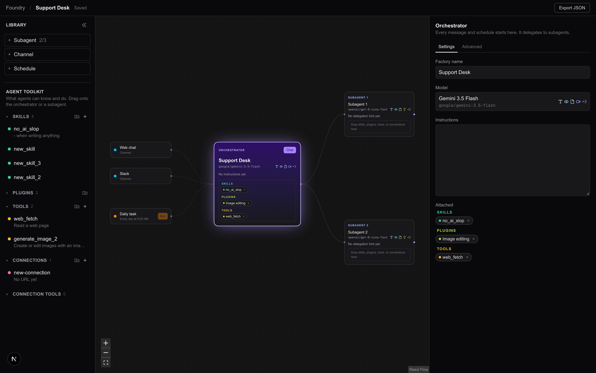

# Foundry

A visual builder for AI agent factories, built on [eve](https://eve.dev). Lay out an orchestrator and its subagents on a canvas, then give them skills, plugins, tools, and connections to external services and MCP servers. Wire up channels like web chat and Slack, schedule recurring tasks, and chat with the factory right from the builder.



Every factory runs on one shared eve deployment. Factories are stored as data and built into an agent at runtime, so edits apply from the next message without a redeploy. See [architecture.md](architecture.md) for details.

## Layout

- `agent/`: the shared eve agent that runs every factory
- `apps/web`: the Next.js builder
- `packages/factory`: Prisma schema, database reads, secrets, and connection sign-in

## Getting started

Add a `.env.local` at the root with:

```bash
DATABASE_URL=postgres://...
FOUNDRY_SECRETS_KEY=...
```

Then link it into `apps/web`, install, migrate, and start the builder:

```bash
ln -s ../../.env.local apps/web/.env.local
npm install
npm run db:migrate
npm run dev:web
```

To talk to the agent directly in eve's dev TUI, run `npm run dev`.

## Deploy

```bash
npm run deploy
```

See the [eve deployment docs](https://eve.dev/docs/guides/deployment/vercel) for authentication and environment variables.
