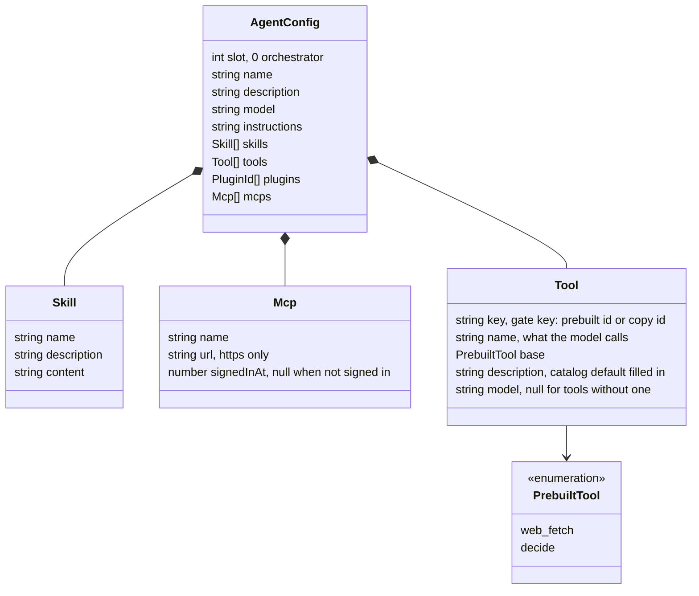
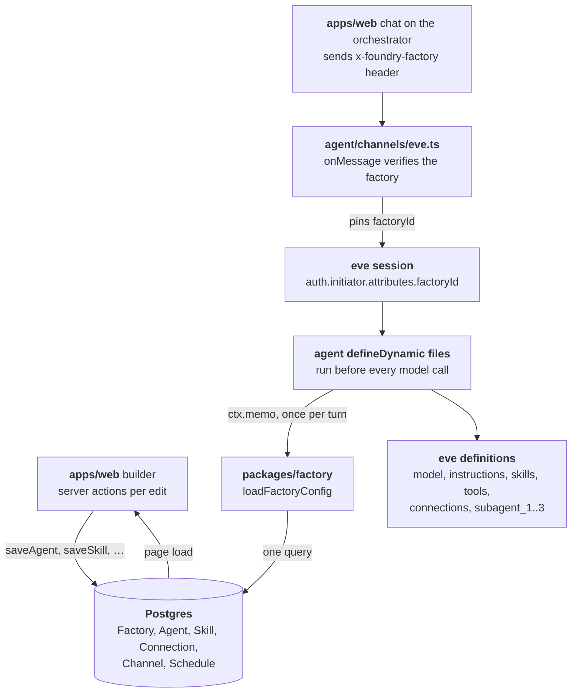

# Foundry
This project is a visual editor for creating AI factories using eve as a base agent framework. It allows the user to interact with the eve framework via GUI. They can create subagnets, custom skills, connect to external MCPs and APIs, and communicate with their factories via multiple. We'll create some basic prebuilt constructs like an opinionated take on web_search and browser_use

## Runtime model
One shared, multi-tenant eve deployment serves every factory. Factories are data (DB + blob), not eve source files. Each session resolves its `factoryId` from auth, and `defineDynamic` files build that factory's agent before every model call (cached with `ctx.memo`, keyed per turn/config version).

| Factory concept | eve mechanism | Editable live |
|---|---|---|
| Model (root + each subagent) | dynamic `model` / dynamic subagent `defineAgent` | Yes |
| Instructions | dynamic `defineInstructions` | Yes |
| Skills | dynamic `defineSkill` map | Yes |
| MCPs / APIs | dynamic `defineMcpClientConnection` / `defineOpenAPIConnection` | Yes |
| Prebuilt tools (web_fetch, …) | shipped in runtime, toggled via dynamic tools | Yes (toggle/config only) |
| Plugins (CLI tools + skills) | catalog in code, CLIs baked into the sandbox template | Yes (toggle/config only) |
| Custom code tools | user code runs in the sandbox via a generic tool | Yes |
| Schedules | `defineDynamicSchedules` (experimental) | Yes |
| Subagents | pre-declared generic slots | Partly |
| Channels | all channels shipped, gated per factory | Partly |

Later: compile a factory's config into a standalone eve project for export or dedicated deploys.

## Limitations & decisions
- **Build-time vs runtime:** tool code, subagent directories, and channels are fixed at build time. Users configure and compose; they don't ship code into the runtime.
- **Subagents:** use a fixed number of generic slots (`agent/subagents/subagent_N/`) whose files are all dynamic. Slot count and nesting depth are capped. A deeper or larger setup can call another factory as a remote agent.
- **Channels:** every channel is installed; a factory's enabled flag gates incoming messages in channel auth/hooks. v1 uses Foundry-owned bots (e.g., one Slack app across many workspaces, with a bot token per `teamId`). Bring-your-own bots later need custom channels with per-factory routes.
- **User MCPs:** supported. Credentials are resolved in `auth.getToken`, never put in memos, prompts, or the sandbox. Block private/metadata IPs and require https. Set `instanceKey` per configured MCP. Treat MCP tools as untrusted and use approvals for writes.
- **Connection sign-in:** happens in the builder, never in a chat, so agents never handle tokens and scheduled turns can use the sign-in. A sign-in belongs to the connection, not to whoever is chatting (`principalType: "app"`). See [Connection sign-in](#connection-sign-in).
- **Tenant isolation:** all config loading goes through one tenant-scoped loader. A bug there leaks data across factories, so test it heavily.
- **Shared blast radius:** a bad deploy affects every tenant, and deploys reset memo caches. Per-tenant quotas protect against noisy neighbors and feed token billing.
- **Prompt cache:** switching models mid-session reduces cache reuse.
- **Single user (descoped):** no accounts or ownership checks. Anyone who can reach the app can edit and chat with any factory, so don't expose it publicly yet. Factories are still isolated from each other.
- **`web_search` per factory:** eve's `web_search` is a provider tool and can only be static, so it can't be switched on per factory. We'll build our own as a `defineTool`.

## Implementation (v1)
- **Layout:** npm workspaces. The root is the eve agent (`agent/`). `apps/web` is the Next.js builder. `packages/factory` holds the Prisma schema and client, the shared types and constants (`src/index.ts`), the database reads (`src/db.ts`), secret encryption (`src/secrets.ts`), and connection sign-in (`src/auth/`).
- **Storage:** Postgres via Prisma, in the tables under [Data model](#data-model). The builder's server actions (`apps/web/app/factories/actions.ts`) do the writes.
- **Hosting:** Next.js hosts the agent (`withEve`, `eveRoot: "../.."`). The builder's chat calls `/eve/v1/*` on the same origin.
- **Factory selection:** the chat sends an `x-foundry-factory` header. The eve channel's `onMessage` checks that the factory exists and copies its ID into the session's auth attributes. Dynamic files read it from `auth.initiator`, so it's pinned for the whole session and inherited by subagent sessions.
- **Live edits:** the builder autosaves. The agent memoizes the factory per turn, so edits apply from the next message.
- **Wired up:** model, instructions, skills, prebuilt tools (`web_fetch`, `decide`), plugins (see [Sandboxes](#sandboxes)), MCP connections (https only, no localhost or IP literals), and 3 subagent slots, one level deep. `defaultTools` is off, so a factory only gets the tools attached to it.
- **Connector catalog:** the Connections **+** opens one list of services from two sources (`apps/web/app/factories/connector-catalog/`). The picker never says which source a service came from.
  - **Vercel Connect:** the MCP services Connect signs in to with its own OAuth client (about 520). Finding them needs Connect's per-service detail, which needs a Vercel login, so they're a committed snapshot refreshed with `npm run sync:connect` in `apps/web`.
  - **ClawHub:** OpenClaw's official connectors only, never community packages. Loaded live and kept in the shared remote cache for hours. Each card links back to its ClawHub listing, as ClawHub asks.
  - **Duplicates:** a service on both keeps Connect's version. Two entries are the same service when their MCP hosts or names match.
  - **Channels** (Slack, Discord, Teams, Telegram) stay out of the catalog; they come from eve.
  - The page starts loading the catalog without waiting on it, so the picker is usually ready when it opens.
  - Adding a connector creates a connection with the server's URL; OAuth connectors are then signed in from the inspector. API-key connectors (servers whose manifest reads a token from a header) are disabled until header credentials are built. Icons go through `/connector-icons/[hash]`: Connect's from the snapshot, ClawHub's proxied because ClawHub serves them same-origin only. Custom URLs still work.
- **Saved but not live:** channels (the orchestrator's Chat button always works) and schedules.
- **Not built yet:** `web_search` (see above), `browser_use` (needs a real sandbox: Docker or Vercel), API-key/header auth for MCPs, and rendering of approvals/questions in the chat.

### Connection sign-in
One module, `packages/factory/src/auth/` (`@foundry/factory/auth`), handles all three sign-in methods, tried in this order:
1. **`vercel-connect`** (`auth/vercel-connect.ts`): Connect provisions a managed OAuth connector for the server URL (`POST /v1/connect/connectors/managed/oauth`, UID `host/foundry-<urlhash>`), runs the OAuth, and keeps the tokens. The subject is the connection (`foundry-connection-<id>`) until there are accounts. Needs the Vercel OIDC token, so locally it needs `vercel link` and `vercel env pull`. Without one, Foundry falls back to its own client.
2. **`client-metadata`** (`auth/oauth.ts`): Foundry's own OAuth client, identified by the document at `/oauth/client-metadata.json` (its URL is the client id). Only on a public https origin, and only for servers that advertise `client_id_metadata_document_supported`.
3. **`dynamic-registration`** (`auth/oauth.ts`): Foundry registers itself at the server's `registration_endpoint` once per issuer and redirect URI, and caches the result in `RegisteredClient`.

- **Flow:** the inspector's Sign in button opens `/oauth/start` in a popup. It discovers the server (401 `WWW-Authenticate`, RFC 9728 resource metadata, then RFC 8414/OIDC metadata), keeps the attempt (PKCE verifier, client, state) in an encrypted, httpOnly cookie scoped to the callback, and redirects to the consent page. `/oauth/callback` exchanges the code, stores the credential, and tells the builder over the `foundry:sign-in` BroadcastChannel. The builder only ever sees a `SignInStatus`.
- **Safety:** every URL a server hands back must pass `isAllowedMcpUrl`, and nothing follows redirects. The issuer must match its metadata, and the resource must be a prefix of the server URL. Tokens are only sent to the exact URL that signed in. Saving a new URL signs the connection out, and deleting a connection revokes its Connect grant.
- **Runtime:** `agent/lib/factory.ts` gives signed-in connections `auth: { principalType: "app", getToken, evict }`. `getToken` calls `connectionToken`, which refreshes under a `SELECT … FOR UPDATE` row lock, so concurrent turns refresh once. Servers that rotate refresh tokens revoke the whole grant when an old one is reused. A rejected refresh sets `needsReconnect`, and calls then fail with `ConnectionAuthorizationFailedError` (`signed_out`) until someone signs in again. `instanceKey` includes `signedInAt`, so a new sign-in gets a fresh client.
- **Coverage:** all 50 OAuth servers in the ClawHub catalog passed discovery. 16 accept a client metadata document and 34 need dynamic registration.

## Data model
### Principles
- **The orchestrator is the rock.** Every factory has exactly one orchestrator. It's created with the factory and can't be deleted or moved. Everything else hangs off it.
- **The canvas shows structure, not wiring.** The only canvas nodes are the orchestrator, subagents, channels, and schedules. Users never draw edges: each node attaches to the orchestrator when it's dropped, and the edges are derived from the data.
- **Capabilities live inside agents, not next to them.** Skills, tools, and connections (MCPs) are items in a **library**. Users drag them onto the orchestrator or a subagent, and they show up as chips on that card.
- **Illegal shapes can't be stored.** The schema itself enforces the rules below, so neither the UI nor the compiler has to check them.

| Rule | Enforced by |
|---|---|
| Exactly one orchestrator per factory | `Agent.slot = 0`, `@@unique([factoryId, slot])`, created with the factory |
| At most 3 subagents, no nesting | `slot` is limited to 0–3 by a check constraint; agents have no parent field |
| Channels and schedules only trigger the orchestrator | `Channel` and `Schedule` belong to `Factory`, not to `Agent` |
| One install of each channel kind per factory | `@@unique([factoryId, kind])` |
| An attached skill or connection belongs to the same factory `saveAgent` keeps only IDs from the agent's own factory |

### Builder layout
```
┌──────────────┬──────────────────────────────────────────────────────┬────────────────┐
│ LIBRARY      │  TRIGGERS           ORCHESTRATOR          SUBAGENTS  │ INSPECTOR      │
│ Skills    +  │                                                      │ (orchestrator  │
│  ▪ triage    │  ┌─────────┐      ╔══════════════════╗   ┌─────────┐ │  when nothing  │
│  ▪ refunds   │  │ Slack   │─────▶║ Support Desk     ║──▶│Research │ │  is selected)  │
│ Tools        │  └─────────┘      ║ claude-opus-5.5  ║   │ ▪ web   │ │                │
│  ▪ web_fetch │  ┌─────────┐      ║ instructions…    ║   └─────────┘ │ name, model,   │
│  ▪ bash      │  │ Web chat│─────▶║ ▪ triage ▪ bash  ║   ┌─────────┐ │ instructions,  │
│ Connections+ │  └─────────┘      ║ ▪ linear (MCP)   ║──▶│Billing  │ │ attached items │
│  ▪ linear    │  ┌─────────┐      ║ [ Chat ]         ║   │ ▪refunds│ │                │
│              │  │ ⏰ 9am  │─────▶╚══════════════════╝   └─────────┘ │                │
│ + Subagent   │  └─────────┘                                         │                │
│ + Channel    │                                                      │                │
│ + Schedule   │   drag skills/tools/connections onto any agent card  │                │
└──────────────┴──────────────────────────────────────────────────────┴────────────────┘
```
- **Orchestrator card:** pinned at the canvas origin. It's larger, styled differently from the other cards, and shows its model, the start of its instructions, and its attached items inline. It's also where you open the chat, and it's what the inspector shows when nothing else is selected.
- **Lanes:** triggers (channels and schedules) sit on the left and feed in; subagents sit on the right and receive delegated work. Cards can move up and down their lane, but they can't be connected to anything other than the orchestrator.
- **Library:** the left sidebar lists the factory's skills, tools, and connections. Clicking an item opens it in the inspector. Skills get a wide markdown editor; connections get a URL field (credentials come later). Dragging an item onto an agent card attaches it, and the chip's × detaches it. Deleting an item from the library detaches it everywhere.
- **Tools:** come from a built-in catalog in code, not the database. The library shows the catalog, and agents store the tool IDs they use.

### Stored: Postgres

```mermaid
erDiagram
    FACTORY ||--|| AGENT : "orchestrator, slot 0"
    FACTORY ||--o{ AGENT : "subagents, slots 1-3"
    FACTORY ||--o{ SKILL : library
    FACTORY ||--o{ CONNECTION : library
    FACTORY ||--o{ CHANNEL : triggers
    FACTORY ||--o{ SCHEDULE : triggers
    AGENT ||--o{ AGENT_SKILL : attaches
    SKILL ||--o{ AGENT_SKILL : "attached to"
    AGENT ||--o{ AGENT_CONNECTION : attaches
    CONNECTION ||--o{ AGENT_CONNECTION : "attached to"
    CONNECTION ||--o| CONNECTION_CREDENTIAL : "signed in with"
    FACTORY ||--o{ PLUGIN_SECRET : "sets env for plugins"
    FACTORY ||--o{ TOOL_COPY : "renames prebuilt tools"
    FACTORY ||--o{ TOOL_SETTING : "configures prebuilt tools and copies"

    FACTORY {
        string id PK "cuid"
        string name
        datetime createdAt
        datetime updatedAt
    }
    AGENT {
        string id PK
        string factoryId FK
        int slot "0 orchestrator, 1-3 subagent; unique per factory"
        string name "orchestrator's is the factory name"
        string description "subagents: when to delegate"
        string model "AI Gateway id"
        string instructions
        string[] tools "prebuilt catalog ids and tool copy ids"
        string[] plugins "plugin catalog ids"
        float y "lane position; orchestrator ignores it"
    }
    SKILL {
        string id PK
        string factoryId FK
        string name "slug, unique per factory"
        string description "when to load it"
        string content "markdown"
        datetime updatedAt
    }
    CONNECTION {
        string id PK
        string factoryId FK
        string name "slug, unique per factory"
        string url "https only"
    }
    CONNECTION_CREDENTIAL {
        string connectionId PK, FK
        string method "vercel-connect | client-metadata | dynamic-registration"
        string serverUrl "the URL it signed in to; tokens go nowhere else"
        string connector "Vercel Connect connector id, nullable"
        string encrypted "own-OAuth tokens and client, AES-256-GCM, nullable"
        datetime expiresAt "access token, nullable"
        boolean needsReconnect "the server rejected a refresh"
        datetime signedInAt
    }
    REGISTERED_CLIENT {
        string issuer PK
        string redirectUri PK
        string clientId
        string encryptedSecret "nullable"
        string authMethod
        datetime createdAt
    }
    AGENT_SKILL {
        string agentId PK, FK
        string skillId PK, FK
    }
    AGENT_CONNECTION {
        string agentId PK, FK
        string connectionId PK, FK
    }
    CHANNEL {
        string id PK
        string factoryId FK
        string kind "web, slack, discord, teams, telegram; unique per factory"
        boolean enabled
        float y
    }
    SCHEDULE {
        string id PK
        string factoryId FK
        string name
        string cron
        string task "prompt sent to the orchestrator"
        boolean enabled
        float y
    }
    TOOL_COPY {
        string id PK
        string factoryId FK
        string base "prebuilt catalog id it runs"
        string name "what the model calls; slug, unique per factory"
    }
    TOOL_SETTING {
        string factoryId PK, FK
        string toolKey PK "prebuilt id or tool copy id"
        string description "empty uses the catalog's"
        string model "AI Gateway id; empty uses the catalog's"
    }
    PLUGIN_SECRET {
        string factoryId PK, FK
        string pluginId PK
        string name PK "env var the plugin declares"
        string encrypted "AES-256-GCM, v1.iv.tag.ciphertext"
        datetime updatedAt
    }
```


- **Deletes:** deleting a factory cascades to everything. Deleting an agent, skill, or connection cascades to its attachment rows only (and a connection's credential). `Agent.tools` is a plain id list, so deleting a tool copy removes its id from agents and drops its gate and settings by hand.
- **Positions:** only `y` is stored. The lane fixes `x`, and the orchestrator is always at the origin.
- **Saving:** each entity saves on its own through an upsert server action (`saveAgent`, `saveSkill`, …, `deleteItem`), 600ms after its last edit. The builder generates IDs, so new items show up instantly. Next.js runs a client's actions in order, so a create always lands before an attach. An agent's save replaces its attachments with only this factory's items.
- **Library scope:** items belong to one factory.
- **Channel settings** (e.g. a Slack `teamId`) get a column when the first non-web channel goes live.

### Prebuilt tool catalog (code)
`packages/factory/src/prebuilt-tools.ts` holds each tool's library summary, default description, and, for a tool that calls a model, the AI Gateway model type and default model. A factory can change the description and model per tool in the inspector (`ToolSetting`). The code itself is fixed.

| Id | Backed by | Model | Notes |
|---|---|---|---|
| `web_fetch` | eve `web_fetch` | none | |
| `decide` | our `defineTool` calling `decide` from `eve/ai` | evaluation, default `typesafe-ai/jev` | Typed boolean/choice/score questions about text; returns answers with probabilities. Evaluation models only run in tools like this. They return no text, so the agent model picker leaves them out. |
| `web_search` | planned: our own `defineTool` | | eve's provider tool can't be toggled per factory |
| `browser_use` | planned | | Needs a real sandbox |

**Tool copies.** The inspector's Duplicate button copies any prebuilt tool, or a copy of one, into a `ToolCopy` row. A copy runs the same code under its own name. It starts with the source's settings and gate and can be renamed or deleted afterward. The model calls it by `name`. Agents attach it by `id`, and its settings and gate are keyed by `id`, so a rename keeps them. The point is per-copy settings: description, model, and approvals. Copy names can't take a prebuilt id, a plugin tool name, or `subagent_N`, which eve also uses for tool names. The runtime gives each copy its base tool. `loadFactoryConfig` fills in catalog defaults, and a plain tool gets its description and model when it's defined for the turn. A copy with result review spreads the shared reviewed workflow tool, which keeps eve's brand and compiled entry point, and sets its description and an approval that reads the copy's gate. A workflow can't close over settings, so its step looks up the model with `loadToolModel(factoryId, ctx.toolName)`.

**Tool gates.** `ToolGate` sets each tool's approvals, keyed like settings. `run` gates the call before it starts: `never` runs it, `once`/`always` ask a person, and `auto` uses eve's `auto()` decision model (Jev). With an empty `criterion`, `auto` is eve's built-in risk review. With one, the criterion replaces it as `auto({ instructions, criteria })`: a call that clearly meets it runs, and anything else asks a person. eve's `auto()` can't deny on its own, and we don't override that. `result` (prebuilt tools and copies only) has a person accept the output.

### Compiled: what the runtime reads
`loadFactoryConfig` runs one Prisma query (agents → attached skills and connections) and returns one `AgentConfig` per agent. Each dynamic file picks its agent by slot. There's no graph walking or name deduplication, because the schema already guarantees those rules. The only filtering left drops unknown tools and MCP URLs that fail the safety check.



### Request flow


### Runtime mapping
Each agent's config is read by the files for its slot: the root `agent/` files for slot 0, and `agent/subagents/subagent_N/` for slot N.

| Compiled field | eve file | eve definition |
|---|---|---|
| orchestrator `model` | `agent/agent.ts` | dynamic `model` |
| `instructions` | `instructions/factory.ts` | `defineInstructions` (system role) |
| `skills[]` | `skills/factory.ts` | map of `defineSkill` |
| `tools[]` | `tools/factory.ts` | map of eve built-in tools |
| `mcps[]` | `connections/factory.ts` | map of `defineMcpClientConnection`, `instanceKey` = `factoryId:slot:name` |
| subagent `name`, `description`, `model` | `subagents/subagent_N/agent.ts` | `defineAgent`, or `null` when the slot is empty |
| `Channel.enabled` (planned) | channel auth/`onMessage` | rejects messages for disabled channels |
| `Schedule` rows (planned) | `defineDynamicSchedules` | sends `task` to the orchestrator |

Session state, which eve keeps:
- `auth.initiator.attributes.factoryId` is set once by the first message's `onMessage`. Subagent sessions inherit it.
- The memo key is `["factory", factoryId, turnId]`, so each turn queries Postgres once.
- Conversation history lives in eve's workflow store, not in Postgres. A `Chat` table can be added later for titles and listing.

### Planned additions
- Header/API-key credentials for MCP connections, stored in `ConnectionCredential` like the OAuth tokens.
- Per-user sign-ins once there are accounts: the Connect subject becomes the user, and chat sign-in through eve's interactive authorization can sit on the same storage.
- `Usage` (factory, agent, model, tokens per turn), for quotas and billing.
- `FactoryVersion` (immutable snapshots) if sessions need to stay on the config they started with.

## Development
### Setup
- **Postgres:** Postgres 17 from Homebrew on `localhost:5432`, database `foundry`. `DATABASE_URL` lives in the root `.env.local`. `apps/web/.env.local` is a symlink to it. Both are gitignored, so recreate them on a new machine.
- **Commands:** `npm install`, then `npm run db:migrate` (migrates and regenerates the Prisma client), then `npm run dev:web` (Next.js plus the eve agent). Pick a free port with `-p`; 3123 is taken by an unrelated server on this machine.
- **`FOUNDRY_SECRETS_KEY`:** in `.env.local`, 32 random bytes in base64 (`openssl rand -base64 32`). Needed in every environment; changing it makes stored plugin secrets unreadable.
- **Model credential:** none is set up. Every chat turn fails at the model call until you add `AI_GATEWAY_API_KEY` to `.env.local` or run `/login` in `npx eve dev`. The model IDs in `MODELS` haven't been checked against AI Gateway.
- **Docs:** read the eve docs in `node_modules/eve/docs/` before writing eve code. Next.js 16 is newer than most training data, so check `node_modules/next/dist/docs/` too.

### Known issues
- **Lint is broken:** the root uses TypeScript 7, and typescript-eslint only supports versions below 6.1, while `apps/web` uses TS 5.9. Typecheck and build still pass (`npx tsc --noEmit` in the root and in `apps/web`; run `next typegen` first if route types are missing). The fix is to choose one TypeScript version for the whole repo.
- **Prisma install scripts:** npm 11 warns that they aren't in allowScripts. Generation and migration work anyway.
- **Prisma 7:** `migrate dev` doesn't regenerate the client; the `migrate` script runs `prisma generate` afterwards.
- **Unsaved edits on leave:** edits made less than 600ms before leaving the page are lost, because pending saves aren't flushed. A failed save shows "Save failed" until reload.
- **No automated tests:** everything was checked by hand in headless Chrome and with SQL queries. The tenant-scoped loader and the save actions should get tests first.
- **Git:** nothing after eve's initial commit has been committed.
- **Connection sign-ins aren't per user:** each connection has one sign-in that every chat and schedule in its factory uses. That's acceptable while Foundry has one user.
- **Sign-in tested with a fake server only:** discovery ran against the real catalog servers. The callback, storage, and refresh lock were tested against a stubbed OAuth server (one-off script, not checked in). Neither the Connect path nor a real consent screen has been tried, because the repo isn't `vercel link`ed and needs a person to approve.

### Gotchas learned
- **Dynamic tools:** they must return `defineTool` values. Provider tools such as `webSearch()` fail the turn with `DefinitionFailedError`.
- **Subagent auth:** subagent sessions inherit the parent's `auth.initiator`, so `factoryId` reaches the subagent slots.
- **React Flow sizes:** the canvas is controlled and its nodes are rebuilt from state on every render. Measured sizes are kept in their own state and passed back as `measured`, or nodes stay hidden. Position changes only update `y`, which keeps cards in their lanes.
- **Save order:** Next.js runs a client's server actions one at a time. The builder relies on that order, for example so a skill is created before an agent save attaches it.
- **Base prompt:** the root `agent/instructions.md` is a short Foundry base prompt. Each factory's orchestrator instructions are added on top through `agent/instructions/factory.ts`.

### State and next steps
- **Test data:** the database has one test factory, "Support Desk", with a web channel, a schedule, a connection whose localhost URL is filtered out, and `web_fetch` on the orchestrator.
- **Likely next work, roughly by value:**
  1. A model credential, then a real end-to-end chat that includes delegating to a subagent.
  2. Our own `web_search` tool.
  3. Rendering approvals and questions in the chat.
  4. Wiring schedules (`defineDynamicSchedules`) and channel gating.
  5. Header/API-key MCP credentials, plus DNS-rebinding protection.
  6. Tests for `loadFactoryConfig` and the save actions.
  7. Fixing lint.

## Sandboxes
For the time being, we wrap sandbox capabilities in tools. There's no general `bash`: the agent can only start programs a plugin allows.

### Plugins
A plugin bundles sandbox CLIs with the skills that teach an agent to use them. It's one library item: dragging it onto an agent attaches all of it, and the library row expands to show what's inside.

- **Catalog:** `packages/factory/src/plugins.ts`, in code like prebuilt tools. `Agent.plugins` stores the ids. Today: `image_editing` (ImageMagick) and `video_editing` (ffmpeg). Neither needs credentials yet.
- **Install:** `agent/sandbox.ts` installs every plugin's apt packages in the template's `prepare`, so sessions start with them. Adding a plugin means a rebuild. just-bash (dev without Docker) skips the install, and the tools say the program isn't installed.
- **Tools:** each CLI becomes one `defineTool` (`agent/lib/plugin-tools.ts`). It takes `command: string[]`, checks the program against the CLI's allow list, and single-quotes every argument, so there's no shell to escape into. `show` returns output images to the model.
- **Skills:** added after the factory's own skills, so a plugin skill wins a name clash.
- **Gates:** keyed by tool name (`ffmpeg`). Only "before it runs" for now; result review needs a top-level workflow tool per CLI.
- **Inspector:** clicking a plugin lists each tool exactly as the model gets it: description, inputs, allowed programs, packages. One source, `cliToolSpec`, feeds both the tool and the panel.
- **Credentials:** a plugin declares the env vars its CLIs read (`env`), so any auth style fits.
  - **Stored** per factory in Postgres (`PluginSecret`), so schedules work without sign-in. AES-256-GCM under `FOUNDRY_SECRETS_KEY` (`packages/factory/src/secrets.ts`), bound to factory/plugin/name. No external vault.
  - **Trade-off:** env + DB leak = everything leaks; no audit; rotation needs a re-encrypt (`v1.` prefix). Upgrade path: KMS via Vercel OIDC inside `secrets.ts`. Vercel env vars ruled out (shared, deploy-time, size-limited).
  - **Flow:** builder is write-only (sees names, never values). Each call loads fresh, passes env to that command only, redacts values in output, fails naming any missing var.
  - **Per CLI:** prefer Vercel Connect where supported (`gh`; `principalType: "app"` for schedules). Block leaky subcommands (`auth`, `config`, `alias`, `extension`). Never run the CLI's own login.
  - **Later:** Vercel Sandbox network-policy header transform, so the CLI never holds the secret.
- **Not built yet:** returning output files to the person in the chat (it renders no files today), and live Homebrew search for long-tail CLIs, installed on first use.

## Monetization
Hosted version is free. We'll try to monetize on tokens. We WILL provide bring-your-own API key, but recommend against it for the legitimate reason that you'll lock yourself in to less model selection, meaning you can't easily optimize model use for specific use cases