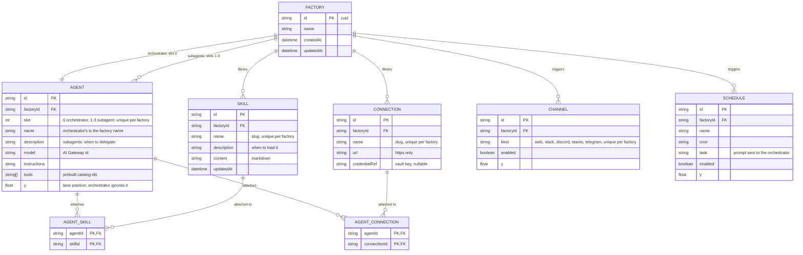
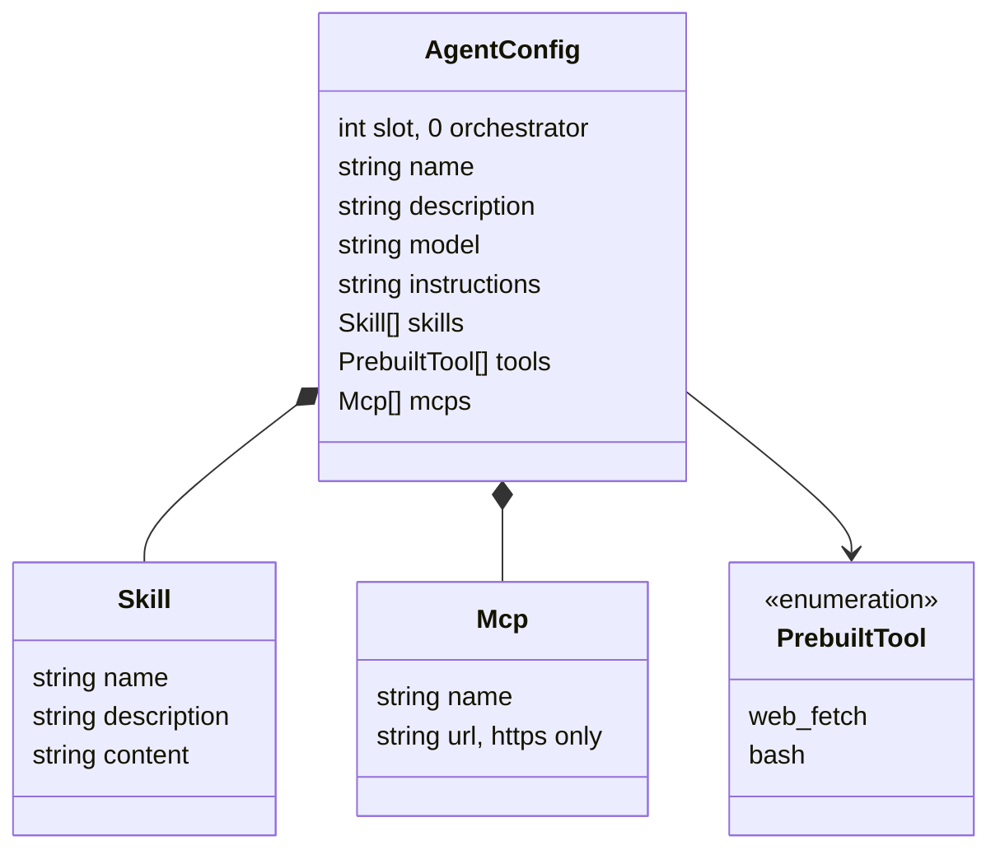
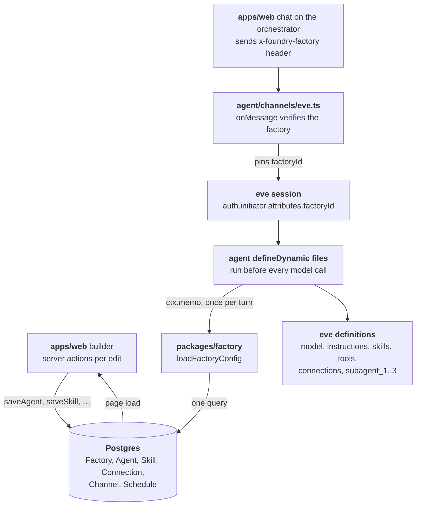

# Foundry
This project is a visual editor for creating AI factories using eve as a base agent framework. It allows the user to interact with the eve framework via GUI. They can create subagnets, custom skills, connect to external MCPs and APIs, and communicate with their factories via multiple. We'll create some basic prebuilt constructs like an opinionated take on web_search and browser_use

## Runtime model
One shared, multi-tenant eve deployment serves every factory. Factories are data (DB + blob), not eve source files. Each session resolves its `factoryId` from auth, and `defineDynamic` files build that factory's agent before every model call (cached with `ctx.memo`, keyed per turn/config version).

| Factory concept | eve mechanism | Editable live |
|---|---|---|
| Model (root + each subagent) | dynamic `model` / dynamic subagent `defineAgent` | Yes |
| Instructions | dynamic `defineInstructions` | Yes |
| Skills | dynamic `defineSkill` map | Yes |
| MCPs / APIs | dynamic `defineMcpClientConnection` / `defineOpenAPIConnection` | Yes |
| Prebuilt tools (web_fetch, bash, …) | shipped in runtime, toggled via dynamic tools | Yes (toggle/config only) |
| Custom code tools | user code runs in the sandbox via a generic tool | Yes |
| Schedules | `defineDynamicSchedules` (experimental) | Yes |
| Subagents | pre-declared generic slots | Partly |
| Channels | all channels shipped, gated per factory | Partly |

Later: compile a factory's config into a standalone eve project for export or dedicated deploys.

## Limitations & decisions
- **Build-time vs runtime:** tool code, subagent directories, and channels are fixed at build time. Users configure and compose; they don't ship code into the runtime.
- **Subagents:** use a fixed number of generic slots (`agent/subagents/subagent_N/`) whose files are all dynamic. Slot count and nesting depth are capped. A deeper or larger setup can call another factory as a remote agent.
- **Channels:** every channel is installed; a factory's enabled flag gates incoming messages in channel auth/hooks. v1 uses Foundry-owned bots (e.g., one Slack app across many workspaces, with a bot token per `teamId`). Bring-your-own bots later need custom channels with per-factory routes.
- **User MCPs:** supported. Store credentials in a vault and resolve them in `auth.getToken`, never in memos or prompts. Block private/metadata IPs and require https. Set `instanceKey` per configured MCP. Treat MCP tools as untrusted and use approvals for writes. OAuth MCPs are limited to services we support through Vercel Connect, unless we build our own OAuth provider.
- **Tenant isolation:** all config loading goes through one tenant-scoped loader. A bug there leaks data across factories, so test it heavily.
- **Shared blast radius:** a bad deploy affects every tenant, and deploys reset memo caches. Per-tenant quotas protect against noisy neighbors and feed token billing.
- **Prompt cache:** switching models mid-session reduces cache reuse.
- **Single user (descoped):** no accounts or ownership checks. Anyone who can reach the app can edit and chat with any factory, so don't expose it publicly yet. Factories are still isolated from each other.
- **`web_search` per factory:** eve's `web_search` is a provider tool and can only be static, so it can't be switched on per factory. We'll build our own as a `defineTool`.

## Implementation (v1)
- **Layout:** npm workspaces. The root is the eve agent (`agent/`). `apps/web` is the Next.js builder. `packages/factory` holds the Prisma schema and client, the shared types and constants (`src/index.ts`), and the database reads (`src/db.ts`).
- **Storage:** Postgres via Prisma, in the tables under [Data model](#data-model). The builder's server actions (`apps/web/app/factories/actions.ts`) do the writes.
- **Hosting:** Next.js hosts the agent (`withEve`, `eveRoot: "../.."`). The builder's chat calls `/eve/v1/*` on the same origin.
- **Factory selection:** the chat sends an `x-foundry-factory` header. The eve channel's `onMessage` checks that the factory exists and copies its ID into the session's auth attributes. Dynamic files read it from `auth.initiator`, so it's pinned for the whole session and inherited by subagent sessions.
- **Live edits:** the builder autosaves. The agent memoizes the factory per turn, so edits apply from the next message.
- **Wired up:** model, instructions, skills, prebuilt tools (`web_fetch`, `bash`), MCP connections (https only, no localhost or IP literals), and 3 subagent slots, one level deep. `defaultTools` is off, so a factory only gets the tools attached to it.
- **Connector catalog:** the Connections **+** opens a browser of OpenClaw's official connectors on ClawHub (`apps/web/app/factories/openclaw.ts`, cached for hours). Only the official list is offered, never community packages. Adding one creates a connection with the server's URL; OAuth connectors still need a Vercel Connect connector to sign in, and API-key connectors are disabled until there's a vault. Icons go through `/connector-icons/[hash]` because ClawHub serves them same-origin only. Custom URLs still work.
- **Saved but not live:** channels (the orchestrator's Chat button always works) and schedules.
- **Not built yet:** `web_search` (see above), `browser_use` (needs a real sandbox: Docker or Vercel), MCP auth, and rendering of approvals/questions/sign-ins in the chat.

## Data model
### Principles
- **The orchestrator is the rock.** Every factory has exactly one orchestrator. It's created with the factory and can't be deleted or moved. Everything else hangs off it.
- **The canvas shows structure, not wiring.** The only canvas nodes are the orchestrator, subagents, channels, and schedules. Users never draw edges: each node attaches to the orchestrator when it's dropped, and the edges are derived from the data.
- **Capabilities live inside agents, not next to them.** Skills, tools, and connections (MCPs) are items in a **library**. Users drag them onto the orchestrator or a subagent, and they show up as chips on that card.
- **Illegal shapes can't be stored.** The schema itself enforces the rules below, so neither the UI nor the compiler has to check them.

| Rule | Enforced by |
|---|---|
| Exactly one orchestrator per factory | `Agent.slot = 0`, `@@unique([factoryId, slot])`, created with the factory |
| At most 3 subagents, no nesting | `slot` is limited to 0–3 by a check constraint; agents have no parent field |
| Channels and schedules only trigger the orchestrator | `Channel` and `Schedule` belong to `Factory`, not to `Agent` |
| One install of each channel kind per factory | `@@unique([factoryId, kind])` |
| An attached skill or connection belongs to the same factory `saveAgent` keeps only IDs from the agent's own factory |

### Builder layout
```
┌──────────────┬──────────────────────────────────────────────────────┬────────────────┐
│ LIBRARY      │  TRIGGERS           ORCHESTRATOR          SUBAGENTS  │ INSPECTOR      │
│ Skills    +  │                                                      │ (orchestrator  │
│  ▪ triage    │  ┌─────────┐      ╔══════════════════╗   ┌─────────┐ │  when nothing  │
│  ▪ refunds   │  │ Slack   │─────▶║ Support Desk     ║──▶│Research │ │  is selected)  │
│ Tools        │  └─────────┘      ║ claude-opus-5.5  ║   │ ▪ web   │ │                │
│  ▪ web_fetch │  ┌─────────┐      ║ instructions…    ║   └─────────┘ │ name, model,   │
│  ▪ bash      │  │ Web chat│─────▶║ ▪ triage ▪ bash  ║   ┌─────────┐ │ instructions,  │
│ Connections+ │  └─────────┘      ║ ▪ linear (MCP)   ║──▶│Billing  │ │ attached items │
│  ▪ linear    │  ┌─────────┐      ║ [ Chat ]         ║   │ ▪refunds│ │                │
│              │  │ ⏰ 9am  │─────▶╚══════════════════╝   └─────────┘ │                │
│ + Subagent   │  └─────────┘                                         │                │
│ + Channel    │                                                      │                │
│ + Schedule   │   drag skills/tools/connections onto any agent card  │                │
└──────────────┴──────────────────────────────────────────────────────┴────────────────┘
```
- **Orchestrator card:** pinned at the canvas origin. It's larger, styled differently from the other cards, and shows its model, the start of its instructions, and its attached items inline. It's also where you open the chat, and it's what the inspector shows when nothing else is selected.
- **Lanes:** triggers (channels and schedules) sit on the left and feed in; subagents sit on the right and receive delegated work. Cards can move up and down their lane, but they can't be connected to anything other than the orchestrator.
- **Library:** the left sidebar lists the factory's skills, tools, and connections. Clicking an item opens it in the inspector. Skills get a wide markdown editor; connections get a URL field (credentials come later). Dragging an item onto an agent card attaches it, and the chip's × detaches it. Deleting an item from the library detaches it everywhere.
- **Tools:** come from a built-in catalog in code, not the database. The library shows the catalog, and agents store the tool IDs they use.

### Stored: Postgres


- **Deletes:** deleting a factory cascades to everything. Deleting an agent, skill, or connection cascades to its attachment rows only.
- **Positions:** only `y` is stored. The lane fixes `x`, and the orchestrator is always at the origin.
- **Saving:** each entity saves on its own through an upsert server action (`saveAgent`, `saveSkill`, …, `deleteItem`), 600ms after its last edit. The builder generates IDs, so new items show up instantly. Next.js runs a client's actions in order, so a create always lands before an attach. An agent's save replaces its attachments with only this factory's items.
- **Library scope:** items belong to one factory.
- **Channel settings** (e.g. a Slack `teamId`) get a column when the first non-web channel goes live.

### Prebuilt tool catalog (code)
| Id | Backed by | Notes |
|---|---|---|
| `web_fetch` | eve `web_fetch` | |
| `bash` | eve `bash` | Runs in the sandbox |
| `web_search` | planned: our own `defineTool` | eve's provider tool can't be toggled per factory |
| `browser_use` | planned | Needs a real sandbox |

### Compiled: what the runtime reads
`loadFactoryConfig` runs one Prisma query (agents → attached skills and connections) and returns one `AgentConfig` per agent. Each dynamic file picks its agent by slot. There's no graph walking or name deduplication, because the schema already guarantees those rules. The only filtering left drops unknown tools and MCP URLs that fail the safety check.



### Request flow


### Runtime mapping
Each agent's config is read by the files for its slot: the root `agent/` files for slot 0, and `agent/subagents/subagent_N/` for slot N.

| Compiled field | eve file | eve definition |
|---|---|---|
| orchestrator `model` | `agent/agent.ts` | dynamic `model` |
| `instructions` | `instructions/factory.ts` | `defineInstructions` (system role) |
| `skills[]` | `skills/factory.ts` | map of `defineSkill` |
| `tools[]` | `tools/factory.ts` | map of eve built-in tools |
| `mcps[]` | `connections/factory.ts` | map of `defineMcpClientConnection`, `instanceKey` = `factoryId:slot:name` |
| subagent `name`, `description`, `model` | `subagents/subagent_N/agent.ts` | `defineAgent`, or `null` when the slot is empty |
| `Channel.enabled` (planned) | channel auth/`onMessage` | rejects messages for disabled channels |
| `Schedule` rows (planned) | `defineDynamicSchedules` | sends `task` to the orchestrator |

Session state, which eve keeps:
- `auth.initiator.attributes.factoryId` is set once by the first message's `onMessage`. Subagent sessions inherit it.
- The memo key is `["factory", factoryId, turnId]`, so each turn queries Postgres once.
- Conversation history lives in eve's workflow store, not in Postgres. A `Chat` table can be added later for titles and listing.

### Planned additions
- A vault entry behind `Connection.credentialRef`, resolved in the connection's `auth.getToken`.
- `Usage` (factory, agent, model, tokens per turn), for quotas and billing.
- `FactoryVersion` (immutable snapshots) if sessions need to stay on the config they started with.

## Development
### Setup
- **Postgres:** Postgres 17 from Homebrew on `localhost:5432`, database `foundry`. `DATABASE_URL` lives in the root `.env.local`. `apps/web/.env.local` is a symlink to it. Both are gitignored, so recreate them on a new machine.
- **Commands:** `npm install`, then `npm run db:migrate` (migrates and regenerates the Prisma client), then `npm run dev:web` (Next.js plus the eve agent). Pick a free port with `-p`; 3123 is taken by an unrelated server on this machine.
- **Model credential:** none is set up. Every chat turn fails at the model call until you add `AI_GATEWAY_API_KEY` to `.env.local` or run `/login` in `npx eve dev`. The model IDs in `MODELS` haven't been checked against AI Gateway.
- **Docs:** read the eve docs in `node_modules/eve/docs/` before writing eve code. Next.js 16 is newer than most training data, so check `node_modules/next/dist/docs/` too.

### Known issues
- **Lint is broken:** the root uses TypeScript 7, and typescript-eslint only supports versions below 6.1, while `apps/web` uses TS 5.9. Typecheck and build still pass (`npx tsc --noEmit` in the root and in `apps/web`; run `next typegen` first if route types are missing). The fix is to choose one TypeScript version for the whole repo.
- **Prisma install scripts:** npm 11 warns that they aren't in allowScripts. Generation and migration work anyway.
- **Prisma 7:** `migrate dev` doesn't regenerate the client; the `migrate` script runs `prisma generate` afterwards.
- **Unsaved edits on leave:** edits made less than 600ms before leaving the page are lost, because pending saves aren't flushed. A failed save shows "Save failed" until reload.
- **No automated tests:** everything was checked by hand in headless Chrome and with SQL queries. The tenant-scoped loader and the save actions should get tests first.
- **Git:** nothing after eve's initial commit has been committed.
- **Shared Connect identity (tech debt):** MCP connections get Vercel Connect tokens with `principalType: "app"`, so every factory that uses a given connector acts as the same account. That's acceptable while Foundry has one user. Once it has accounts, tokens need to be scoped per factory or per user.

### Gotchas learned
- **Dynamic tools:** they must return `defineTool` values. Provider tools such as `webSearch()` fail the turn with `DefinitionFailedError`.
- **Subagent auth:** subagent sessions inherit the parent's `auth.initiator`, so `factoryId` reaches the subagent slots.
- **React Flow sizes:** the canvas is controlled and its nodes are rebuilt from state on every render. Measured sizes are kept in their own state and passed back as `measured`, or nodes stay hidden. Position changes only update `y`, which keeps cards in their lanes.
- **Save order:** Next.js runs a client's server actions one at a time. The builder relies on that order, for example so a skill is created before an agent save attaches it.
- **Base prompt:** the root `agent/instructions.md` is a short Foundry base prompt. Each factory's orchestrator instructions are added on top through `agent/instructions/factory.ts`.

### State and next steps
- **Test data:** the database has one test factory, "Support Desk", with a web channel, a schedule, a connection whose localhost URL is filtered out, and `web_fetch` on the orchestrator.
- **Likely next work, roughly by value:**
  1. A model credential, then a real end-to-end chat that includes delegating to a subagent.
  2. Our own `web_search` tool.
  3. Rendering approvals and questions in the chat.
  4. Wiring schedules (`defineDynamicSchedules`) and channel gating.
  5. MCP credentials (`Connection.credentialRef`), plus DNS-rebinding protection.
  6. Tests for `loadFactoryConfig` and the save actions.
  7. Fixing lint.

## Sandboxes
For the time being, we wrap sandbox capabilities in tools

## Monetization
Hosted version is free. We'll try to monetize on tokens. We WILL provide bring-your-own API key, but recommend against it for the legitimate reason that you'll lock yourself in to less model selection, meaning you can't easily optimize model use for specific use cases